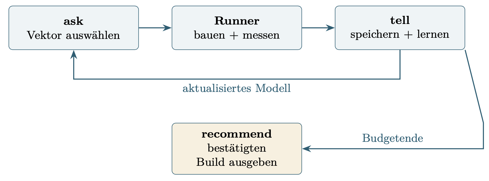
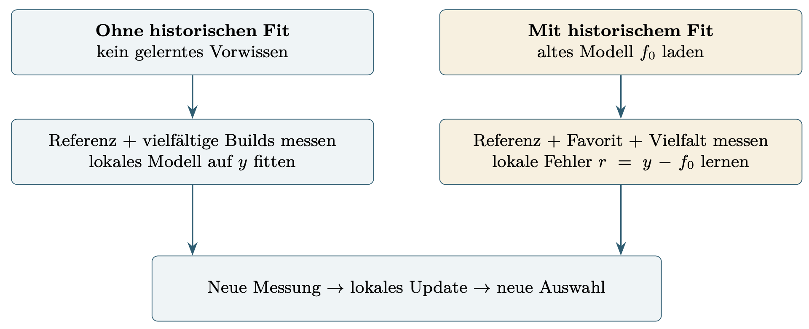

# Active Sampling

## Approach

**Goal:** Find good build-options with little amount of measurements *(Bayesian Optimization)*

**Workflow:** We do 25 measurements and after each measurement we refine the function approximation

## Reuse in the Current Setup

**Models:** keep current models, add update feature

**Search:** current all combination testing to UCB

**Validation:** keep validation process (has to be restructured, because currently we have mutliple sources with valid and invalid combinations)

## Use Data from other HW

### Possible Workflow with Historic Data Fitting

$\widehat y_t(h,x) = f_0(h,x) + g_t(x)$

1. fit historic model on the data ($f_0$)
2. freeze historic model
3. use additional model for correction ($g_t$)

- both models have same target scale
- *example:* historic ridge regression model + local gaussian process

**Assumption:** build options work similar on different HW (one combination bad on one HW = also bad on another HW)

## Suggestions for Adapting Current Models

| Model             | No Pretraining                              | With Pretraining                                                                                                         |
| ------------------ | ------------------------------------------------------------ | ------------------------------------------------------------------------------------------------------------------------------- |
| Ridge    | refit after initial measurement + uncertainty to UCB | freeze $f_0$ + local correction (*alternativ:* kontext relevant total refit)                                             |
| GP                 | fit local GP (mean + uncertainty to UCB)  | $f_0$ as mean + residual GP (*optional:* one GP on $H+n$ data points)                                           |
| RF / CatBoost      | local trees + Bootstrap for UCB                     | freeze prelearned trees + correction model                                                    |
| Kernel Ridge / SVR | local fit + Bootstrap for UCB                           | freeze historic fit + local correction model                                  |
| MLP                | local net + Bootstrap for UCB.                            | freeze net + local correction model (Possible change: change architecture to keep learning)|

## New Options to Integrate

| New Option                          | No Initial Fit                                                                | With Initial Fit                                                                                              |
| ---------------------------------- | ----------------------------------------------------------------------------------------------- | -------------------------------------------------------------------------------------------------------------------------- |
| Online Bayes Regression            | linear function with chosen interactions (regular prior + local updates) | learned coefficient prior or historic $f_0$ + local correction                                              |
| chategorical GP                   | kernel compares flag values according to chategories (local initial measurements)                     | historic $f_0$ + Residual GP                                       |
| Hierarchical / Multi-Task-GP | one local Task-GP (*without history little benefit*)                                         | learn structure between machines $\rightarrow$ add new HW as a new task                         |
| SMAC with Random Forest        | tree-surrogate with initial design (choose  with aquisition function)                           | Information from different machine: use some features or self-made transfer adapter     |
| TPE                        | density for good/bad configuration *(instead of function)*         | Information from different machine: remeasure as good identified build vectors (not just use old data) |

## Functions for Workflow

### ask

Give next build options to sample/measure.

- no usable model: wide spread sampling
- small pool: random + close to good measurements
- do not take already measured things into account
- UCB

### tell

Refit model on the newly measured data.

### recommend

Give out best build option.

- Reserve measurement budget for last round
- might want to measure multiple finalists
- might want to repeat measurement for everything multiple times (and keep mean or median or something)

## Refitting Options

**complete refit:** old + new data, more computational complexity

**local refit:** smaller model

**online update:** add state, needs according algorithm

